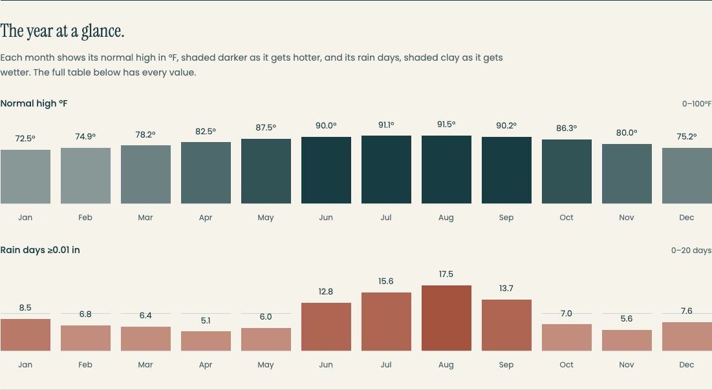

# Waterline chart patterns

Use this catalog after the four tests in [Guide figures](guide-figures.md) pass.
Choose the treatment that makes the existing numerical comparison easiest to
understand. Name that choice in the existing design packet; charts are optional.

## Selected reference: Seasonal rhythm (weather option B)

On November 3, 2026, Sawyer selected B from the rendered current/A/B weather
comparison and requested charts like it as future design choices. B is the
selected weather direction, not a published weather migration. The public
article, SEO, source table and booking contracts remain unchanged in this work.

B uses two aligned monthly plots: normal high temperature in marine ink and
rain days in clay. Every month has its exact value printed above its mark.
The weather preview uses existing guide data and explicit scales of 0–100°F
and 0–20 rain days. Those are plotting bounds, not new climate facts. Keep the
original explanation, source note and complete table below the figure.

[Selected B on a phone](chart-patterns/seasonal-rhythm-phone.png)

Desktop keeps all twelve months aligned. Phone uses four months per row,
stacking the two plots with every value visible and no horizontal scrolling.
B is taller on phones than the compact strip: compare the source/table and
booking positions in rendered review. Never shrink labels or hide the table
just to save height.

This reference passed preview checks at 1261, 768, 393, 375 and 360px, preserving
full article copy, metadata, schema, data, photos and link/tracking identities.
It had no page overflow or serious/critical axe findings. These are bounded
preview results, not production behavior or conversion-lift evidence.

## Choose by the reader's question

| Existing data and decision | Treatment | Design choice |
| --- | --- | --- |
| Two seasonal measures with different units: when fits my trip? | **Paired seasonal plots (B)** | Separate aligned plots, explicit scale per measure, exact labels; no overlaid dual axes. |
| Exact monthly values matter more than the trend shape | **Monthly climate strip (A)** | Open ruled columns, direct labels, ink/clay shading; four columns on phones. |
| Several comparable numerical options: how do amounts compare? | **Horizontal bars** | Shared zero baseline, unit and end labels; meaningful source order or an explicit sort. Qualitative destination comparisons stay tables. |
| Published observations over time: how did this change? | **Time-series line** | Actual intervals and visible points; gaps stay gaps. No smoothing, forecasts or invented observations. Climate normals remain normals, not a live forecast. |
| Published lower/upper values: what range should I plan for? | **Range marks** | Name both endpoints and unit. A range is not a precise average or current quote. If the guide only says price your dates, retain its qualitative tiers. |

B is the selected rendered reference; A remains the compact alternative.
Horizontal bars, lines and ranges are available design choices, not preapproved
page layouts or new factual claims. They still need page-specific rendered
variants and review. A guide with no useful numerical comparison keeps its
words, photographs or table.

## Shared treatment

- Use Waterline paper/soft surfaces, ink marks, clay rain/cautions and quiet
  rules. Poppins carries values/units; Instrument Serif carries editorial
  headings. Avoid dashboard chrome, gradient cards and decorative percentages.
- Label values, units, period and source. Color supports the answer; direct
  labels carry it. Tint the fill rather than lowering a parent's opacity,
  which also fades its text. No essential hover-only values.
- Bars start at zero. Lines/ranges may use another clearly labeled domain
  when it explains the data honestly. Never shorten a scale to exaggerate a
  difference or copy the weather bounds onto an unrelated dataset.
- Keep one subject-specific figure after the answer and retain the complete
  accessible source table. Paired plots count as one labeled figure, not a
  dashboard of several cards.
- Prefer semantic HTML/CSS or build-time SVG with real text. Keep the figure
  complete without JavaScript and within existing speed budgets. Reuse a
  suitable existing component. This catalog installs no framework, chart
  package or animation library.
- Keep the existing text, mobile-target, focus and reduced-motion floors.
  Static plots need no animation. Check 360, 375 and 393px plus tablet/desktop:
  no clipped labels, hidden months, sideways page scroll or booking obstruction.
- Preserve original reader copy, SEO/schema, source data, photographs and
  booking/tracking links through a presentation-only change.

## Agent route

Read the real guide/dataset, apply guide-figures.md, then choose a pattern and
explain its scale, mobile behavior and booking-path tradeoff in the existing
design packet. Use the design-specialist/critic lane and rendered alternatives
under [Design review](../process/design-review-workflow.md). Reuse Sawyer's B
selection for the weather option; do not ask him to choose it again.

Apply a selected pattern only within the named page's authorized scope.
Choosing a pattern does not authorize other guide changes, new facts, paid
research or publication.

[Mebius charts](https://mebius.design/freebies/charts) was a visual reference.
No Mebius code, assets or license rights are included. Actual third-party reuse
needs its specific license checked first. The screenshots above are Seascape's
own local weather preview.
