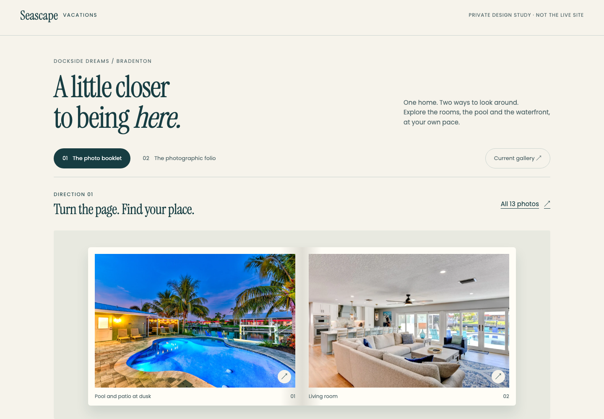
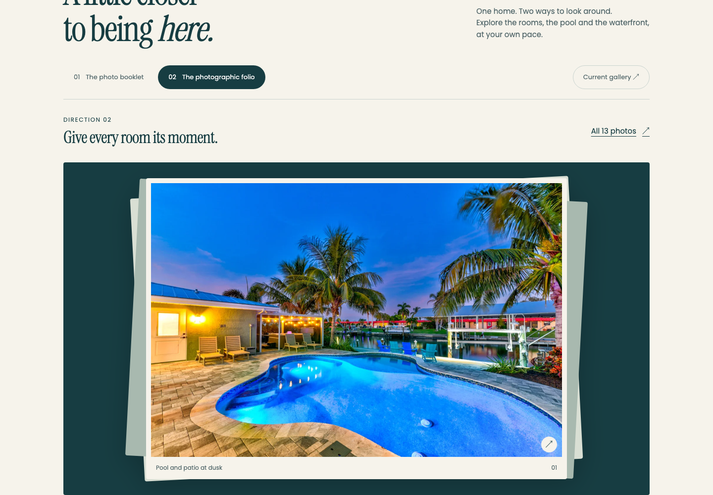

# Review evidence — November 17, 2026

Scope: private Dockside Dreams concepts and existing Site catalog/workflow.
Production base: `2f3afe2ddd4671e056ce08615692de321e8f6847`.

## Rendered choices

| Booklet — recommended | Photographic folio — alternative |
| --- | --- |
|  |  |
| [Phone booklet, full page](proof/book-390.png) | [Phone folio, full page](proof/folio-390.png) |

Current built gallery: [desktop](proof/baseline-1440.png),
[phone](proof/baseline-390.png). Both baseline captures load the lower gallery's
lazy images before capture. Compare photo treatment, not the different amount
of property-page content. The original public route is unchanged.

[Watch the booklet interaction](proof/booklet-interaction.webm): three next
turns, one previous turn, open a full-size image and Escape back. This records
actual browser execution. It does not establish real-phone touch feel.

## Targeted acceptance result

Command: `node docs/design/experiments/property-photo-study/verify.cjs`

```text
PASS 6 scenario groups; desktop/mobile photos, axe, navigation interruption,
endpoints, keyboard, focus, reduced motion, error paths
```

The image-decode and grid-ratio checks were added after direct visual inspection
found incorrect asset routing and intrinsic-height blank mats. Both are now
fixed in this preview. The missing full-size image state is also tested.

## Independent rendered critic

Reviewer: native read-only `/root/design_critic`, using the existing Site critic
route. It inspected desktop and phone captures of both concepts and the base.
Returned verdict on November 17, 2026:

> Approved with edge (high confidence on current screenshots). Recommend A,
> the booklet. At 1440 its two-photo spread, quiet paper edges, captions and
> centered seam make a memorable editorial moment while keeping the real home
> photos dominant; at 390 it becomes one generous, undistorted image with
> previous/next, 1/13, reachable thumbnails, an all-photos link and photo grid.
> It gracefully preserves the browsing job. Folio is also visually clear and
> gives the lead image more scale, but its large ink stage and stacked-frame
> treatment read more like a component demo and carry less Waterline warmth.

Remaining edge: check subjective page-turn quality and real-device touch before
adoption. The critic correctly flagged unloaded lower-gallery images in the
first baseline screenshots; those captures were replaced after exercising
lazy loading. They were not classified as production defects.

## Independent pre-publication bug review

Reviewer: fresh native read-only `/root/preview_bug_review`. Complete source
diff and all six preview source files were inspected, plus property data and
rendered desktop/mobile. Returned November 17, 2026:

> 0 findings, nothing needs fixing. merge: no_concerns

Reviewed source-input digest:
`b95e27d8314b20792904b6d064cab0c184dcc1df5cdcd48f531a4205de7b922a`.
The review also ran the six scenario groups. A final narrow follow-up checked
the phone preview label and thumbnail failure text raised to the 12px floor
and the refreshed phone captures: “0 findings on the final CSS delta.” The
reviewer confirmed the label stays visible without wordmark overlap or clipping.
Other subsequent additions are this evidence record and rendered artifacts.

## Spec evidence follow-up

Fresh `/root/catalog_spec_review` compared issue #988 with intended source diff
`6efe4749f7cbe369f926149497d41b39ea27f7809ed8c6c4fa668aff99f20864`.
It found no extra scope, but marked reviewable rendered choices and actual
critic/test receipts missing from the supplied diff. This record and its linked
captures supply that evidence. The same spec reviewer opened the added renders
and returned: “The original finding is resolved.” No preview behavior changed;
no production adoption is implied.

The broader Site gates and exact source-publication state belong in the PR's
Proof section; this record claims only the runs and reviews described above.

## Broader source gates

- Build: passed; previews are absent from public `_site` output.
- Unit suite: 1,415 passed, zero failed.
- Guarded merge-check proof chain: passed (content, unit tests and links).
- Design sync render check: 21/21 cards passed; bundle remains local.
- Full visual suite: 683 passed, 96 skipped, one failed (mobile homepage).
  Unchanged main reproduces the homepage mismatch; tracked in
  [#991](https://github.com/uncfreak1255-code/seascape-vacations-site/issues/991).
- Release gate: blocked by owner-pricing evidence expiring November 17, 2026.
  The same validator fails on unchanged main; existing owner issue
  [#990](https://github.com/uncfreak1255-code/seascape-vacations-site/issues/990).

Source publication stays draft while these broader gates are unresolved. No
baseline, pricing fact, review expiry or enforcement check was weakened.

## Physical page-turn refinement — November 18, 2026

Sawyer requested an actual book page flip in the existing local preview. The
refinement gives the turning sheet front and reverse faces, a full 180-degree
spine rotation, a resting-page mask and moving shade. Phone navigation also
turns a sheet; reduced motion and keyboard navigation remain immediate. The
last odd-photo spread has an endpaper rather than a vacant half.

The targeted verifier passed all **7 scenario groups** after this refinement,
including face identity, full rotation, reverse and phone turns, interruption
and a reduced-motion change during the turn. The new front-face assertion
failed against the earlier implementation, establishing regression coverage.

Mid-turn captures: [front](proof/book-turn-front.png),
[reverse](proof/book-turn-back.png). These supplement the refreshed interaction
recording; they do not establish real-device touch feel. Earlier review receipts
above describe their original source and are not reviews of this refinement.

Sawyer then selected this as a reusable design-system pattern for guides and
photo stories. Native `/root/design_critic` reviewed the refreshed captures
and sampled recording frames: “Approved as an optional design-system pattern.”
No concrete introduced visual issue was found. Its verdict covers the rendered
preview; real-device touch and any production adaptation remain unverified.

Studio readback: the existing `PropertyStorybook` usage notes were updated
through its editable UI and verified after reload. They record the selection,
reuse guidance, source/proof link and motion contract. The existing Studio
preview still uses its older short slide: its Claude editor reached the usage
limit before executing the requested code update. No usage reset, plan change
or claim of animation parity was made.

### Refined source review

Fresh spec reviewer `/root/selected_booklet_spec` read updated issue #988 and
the complete intended diff. It initially inferred that the phone reverse face
hid the next photo, then inspected [the paused phone frame](proof/book-phone-midturn.png)
and withdrew that P1: “The Living room target is already fully visible ...
before teardown.” No missing/wrong requirement or unsolicited scope remained.

Scoped bug reviewer `/root/preview_bug_review` also retracted its blank-photo
claim after rendering. Its remaining P2 is a visual tradeoff: the phone sheet
turns off the edge, hiding part of its rotation. Disposition: intentional. A
single large phone photo remains readable while desktop carries the full
spread metaphor; this is documented rather than expanding phone layout. No
review-driven source repair was made. Real-device feel remains unverified.

Broader visual follow-through: sanctioned baseline workflow44214375484 updated
exactly the approved vertical mobile homepage screenshot (bot commitd1fafe62).
The new capture was inspected. Full visual rerun then passed **684 tests,96
skipped,0 failures** in8.8minutes with2workers. No threshold was changed.
